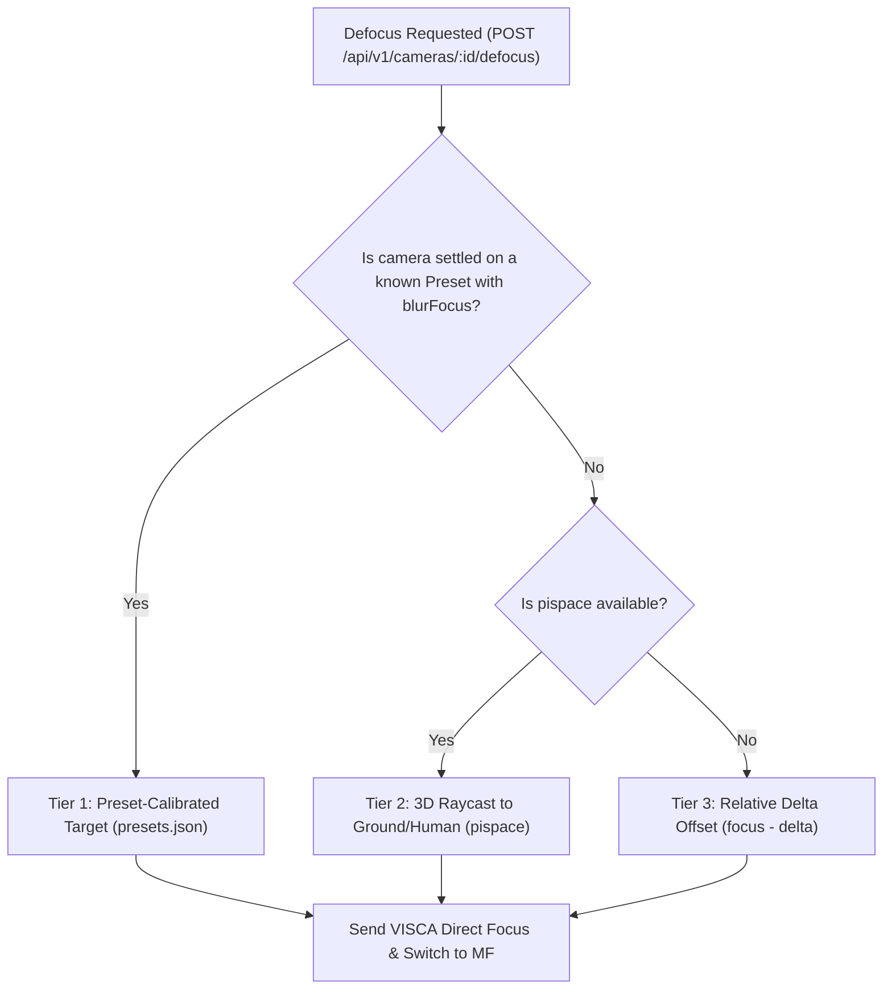

# Spatial & Preset-Aware Privacy Blur Architecture

## 1. Executive Summary & Problem Statement

Riihimäen Keskuskirkko utilizes PTZ cameras (AVer PTZ330) to broadcast services. In pastoral workflows, specific liturgical moments (such as personal prayer, confession, blessings, or communion) require immediate **privacy blur (optical defocus)** to protect individual privacy while maintaining ambient context and dignified aesthetic continuity.

### The Problem with Static Defocus Values
Prior implementations attempted a static focus drive (e.g. driving the lens to its physical near limit `0x0000` / ~158 encoder ticks). Physical testing demonstrated this approach fails in production:
1. **At Wide Angle (e.g. Cam 1 Alttari, zoom ~320)**: Large depth of field means minor focus adjustments do nothing, while driving to the extreme minimum focal plane (<10 cm) creates an abrupt, unnatural whiteout / total blindness ("nothing was visible").
2. **At Telephoto (e.g. Cam 2 Puhuja, zoom ~13888)**: Narrow depth of field means a moderate shift in focal distance produces an immediate, creamy bokeh. Driving to the near limit causes severe over-blur, and the physical lens near limit actually shifts outward at high focal lengths (~4595 encoder ticks).
3. **Unpredictable Free-Roam Movement**: When cameras are operated manually (outside predefined presets), a fixed preset target cannot apply.

---

## 2. Optical Physics & Theoretical Model

### 2.1 Circle of Confusion (Blur Diameter)
The geometric circle of confusion $c$ (blur spot diameter on the sensor) for a subject at distance $d$ when the lens is focused at $d_{\text{blur}}$ is governed by:

$$c = \frac{f^2}{N \cdot (d - f)} \cdot \left| \frac{d - d_{\text{blur}}}{d_{\text{blur}}} \right|$$

Where:
- $f$ is optical focal length ($4.3\text{ mm} \dots 129\text{ mm}$, derived from FreeD zoom $320 \dots 16384$).
- $N$ is lens $f$-number aperture ($f/1.6$ wide to $f/4.7$ telephoto).
- $d$ is metric distance from the camera optical center to the subject.
- $d_{\text{blur}}$ is the intentional defocus distance.

### 2.2 Quadratic Focal Length Scaling ($f^2$)
Because blur diameter scales quadratically with focal length $f^2$:
- At wide angle ($f = 4.3\text{ mm}$), an altar subject $6.3\text{ m}$ away requires focus pulled aggressively forward to $d_{\text{blur}} \approx 1.2\text{ m}$ to conceal facial biometrics.
- At telephoto ($f \approx 110\text{ mm}$), a pulpit subject $15.8\text{ m}$ away only requires focus pulled forward by $\sim 2.5\text{ m}$ ($d_{\text{blur}} \approx 13.3\text{ m}$) to achieve the exact same $35\text{ px}$ circle of confusion on sensor.

### 2.3 PTZ330 Focus Encoder Characteristics
Empirical testing on AVer PTZ330 firmware (V90) confirmed that VISCA Direct Focus commands (`81 01 04 48 0p 0q 0r 0s FF`) map 1:1 linearly to the FreeD telemetry focus encoder ($0\text{x}0000 \dots 0\text{xFFFF}$):
- `0x0400` $\rightarrow$ Encoder `1024`
- `0x0800` $\rightarrow$ Encoder `2048`
- `0x0C00` $\rightarrow$ Encoder `3072`
- `0x1000` $\rightarrow$ Encoder `4096`
- `0x1800` $\rightarrow$ Encoder `6144`

---

## 3. Three-Tier Resolution Hierarchy

To provide reliable defocus across all operational modes, `picam` resolves the target focus value using a 3-tier hierarchy:



### Tier 1: Preset-Calibrated Target (Highest Determinism)
When the camera is recalled to or resting at a known preset:
- Stored preset metadata defines `blurFocus`:
  - **Preset 1 (Altar Wide)**: `blurFocus: 2500` (`0x09C4`)
  - **Preset 2 (Pulpit Zoom)**: `blurFocus: 7000` (`0x1B58`)
- Immediate recall into blur mode without recalculation.
- When presets are recalled while privacy mode is active, `picam` automatically reapplies the preset's calibrated `blurFocus`.

### Tier 2: Spatial Digital-Twin Raycasting (`pispace` + `piperception`)
When the camera is panned or tilted manually without a preset:
1. `picam` queries `pispace`: `GET /api/v1/cameras/:id/privacy-focus`.
2. `pispace` reads live FreeD telemetry `(pan, tilt, zoom)` from UDP `40000`.
3. Optical raycasting projects from camera mount $\mathbf{C}$:
   - **`cam1`**: Chancel pillar $(5.2, 1.5, 3.6)\text{ m}$.
   - **`cam2`**: Rear organ balcony $(0.0, -14.5, 5.0)\text{ m}$.
4. If `piperception` has active 2D human bounding boxes $(u, v)$, the ray is cast through the human centroid.
5. If no human is detected, the ray is cast through the center of the optical frame and intersects:
   - Floor plane: $Z = 0.0\text{ m}$
   - Stage/chancel elevation: $Z = 0.4\text{ m}$
   - Pulpit floor: $Z = 1.3\text{ m}$
   - Standard standing head height: $Z_{\text{subject}} \approx Z_{\text{plane}} + 1.6\text{ m}$.
6. Metric distance $d = \|\mathbf{P} - \mathbf{C}\|$ is calculated.
7. `pispace` computes the exact focus encoder required to produce the standardized blur diameter $c \approx 35\text{ px}$.

### Tier 3: Relative Delta Offset (Autonomous Fallback)
If `pispace` daemon is unreachable or unconfigured:
$$\text{targetFocus} = \max(\text{nearLimit}_{\text{zoom}}, \text{currentFocus} - \Delta(Z))$$
Where $\Delta(Z)$ scales with zoom:
- Wide zoom ($Z < 2000$): $\Delta \approx 3500$
- Medium zoom ($2000 \le Z < 8000$): $\Delta \approx 4000$
- Telephoto ($Z \ge 8000$): $\Delta \approx 4500$

---

## 4. API & Protocol Specifications

### 4.1 `picam` Endpoints
- `POST /api/v1/cameras/:cameraId/defocus`
  - Body: `{ "enabled": boolean, "blurFocus"?: number }`
  - When `enabled: true`: switches to `manual` focus, drives lens to target, sets `privacyBlur: true`.
  - When `enabled: false`: restores normal near limit, returns camera to `auto` focus, sets `privacyBlur: false`.
- `POST /api/v1/cameras/:cameraId/privacy-blur` (alias for backward compatibility).

### 4.2 `pispace` Endpoint Contract
- `GET /api/v1/cameras/:cameraId/privacy-focus`
  - Response:
    ```json
    {
      "cameraId": "cam2",
      "distanceMeters": 15.84,
      "intersectionPlane": "pulpit",
      "humanTarget": true,
      "targetFocusEncoder": 7000,
      "circleOfConfusionPx": 35.2
    }
    ```

### 4.3 Preset Store Schema Extension
`presets.json` schema extended with optional calibrated blur parameters:
```json
{
  "id": 2,
  "name": "Puhuja (Pulpit)",
  "coordinates": {
    "pan": 11,
    "tilt": 1,
    "zoom": 13888,
    "focus": 11500
  },
  "privacy": {
    "blurFocus": 7000,
    "mode": "calibrated"
  }
}
```

---

## 5. Field Calibration Reference (Riihimäen Keskuskirkko)

Physical on-site testing conducted on 2026-11-08 established the following baseline values:

| Camera & View | Zoom | In-Focus (AF) | Soft Blur | Medium Blur (Optimal) | Strong Blur | Near Limit |
|---|:---:|:---:|:---:|:---:|:---:|:---:|
| **Cam 1 (Alttari Wide)** | `320` | `6295` | `3500` | **`2500`** | `1500` | `158` (Over-blur) |
| **Cam 2 (Puhuja Telephoto)** | `13888` | `11495` | `8500` | **`7000`** | `5500` | `4595` (Optical Limit) |

### Visual Criteria:
- **Soft Blur**: Subject features identifiable, fine detail softened.
- **Medium Blur (Target)**: Facial biometrics and identity anonymized; posture, vestments, and liturgical actions recognizable.
- **Strong Blur**: Heavy silhouette, for high-confidentiality pastoral care.

---

## 6. Implementation Milestones

1. **Phase 1 (`picam` presets & protocol)**:
   - Extend `PresetStore` to persist `privacy.blurFocus`.
   - Update `setPrivacyBlur` to use VISCA Direct Focus (`0x48`) instead of near-limit stop.
   - Wire `scheduleBlurReapply` to maintain preset blur on camera travel.
2. **Phase 2 (`pispace` spatial solver)**:
   - Implement `solvePrivacyFocus(cameraId, pan, tilt, zoom, detection2D?)`.
   - Add REST route `/api/v1/cameras/:cameraId/privacy-focus`.
3. **Phase 3 (Perception link & UI integration)**:
   - Ingest `piperception` bounding boxes into `pispace` raycaster.
   - Display active privacy blur status and focal distance overlay in `picontrol`.
